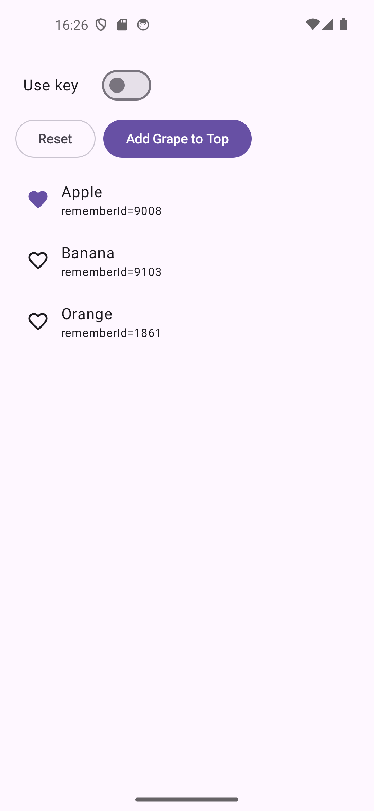
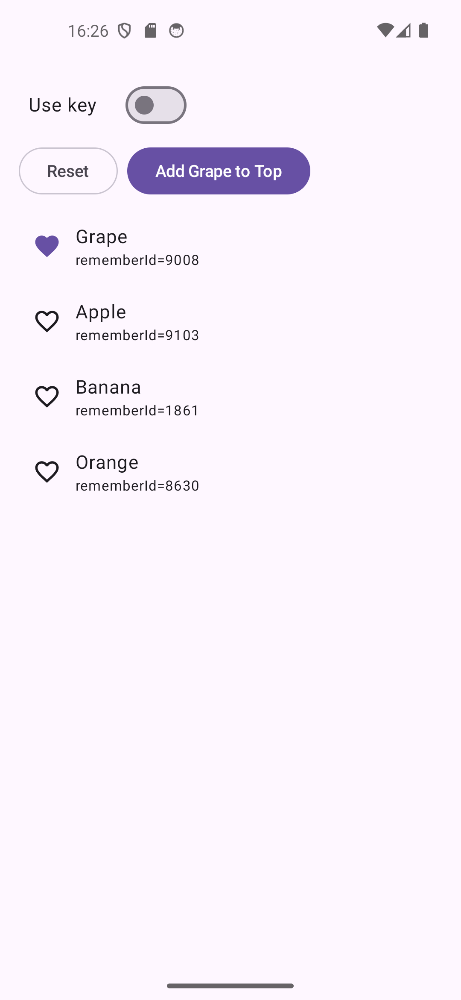
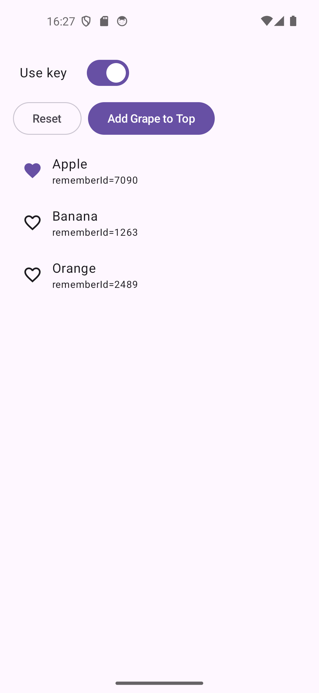
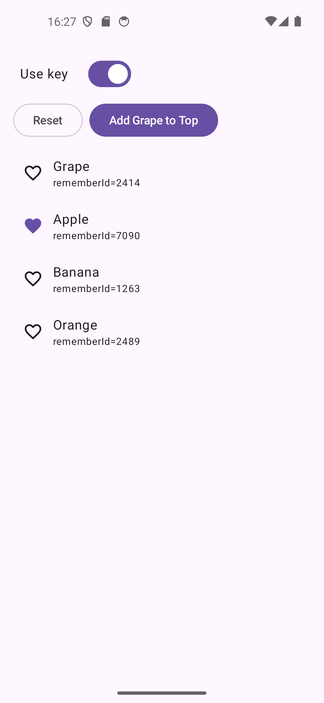

# Compose LazyColumn Key Sample

Qiita記事のサンプルコードとして作成したアプリです。

Jetpack Composeの`LazyColumn`で`key`を指定しない場合に`remember`で保持した状態が別のアイテムへ引き継がれる挙動を、実際に動かして確認できます。

画面上のスイッチで`key`の有無を切り替え、それぞれの状態保持の違いを比較できます。

## サンプルで確認できること

- `LazyColumn`で`key`を指定しない場合の状態保持
- 先頭へのアイテム追加によって`remember`の状態が別のアイテムへ引き継がれる挙動
- `key`を指定した場合に、アイテムと状態が対応したまま保持される挙動
- `remember`で生成した`rememberId`を使った状態の紐付き方の確認
- Logcatでの状態変化の確認

## スクリーンショット

### `key`なし

Appleをお気に入りにした状態で、先頭へGrapeを追加します。

Appleのお気に入り状態がGrapeへ引き継がれます。

### `key`あり

同じようにAppleをお気に入りにした状態で、先頭へGrapeを追加します。

`key = { it.id }`を指定すると、表示位置が変わっても同じ`key`を持つアイテムとして識別されるため、Appleのお気に入り状態はそのまま保持されます。

## 動作モード

画面上部の「Use key」スイッチで、`key`の有無を切り替えられます。

| Mode | 内容 |
|------|------|
| OFF | `key`を指定せず、リストの位置を基準とした状態保持を確認 |
| ON | `key = { it.id }`を指定し、アイテムを識別して状態を保持 |

## 確認手順

1. 「Use key」をOFFにする
2. Appleをお気に入りにする
3. 「Add Grape to Top」を押す
4. Appleのお気に入り状態がGrapeへ引き継がれることを確認する
5. 「Reset」を押す
6. 「Use key」をONにする
7. 同じ手順を実行し、Appleのお気に入り状態が保持されることを確認する

## 動作環境

- Android Studio
- Kotlin
- Jetpack Compose
- Material3

## ライセンス

MIT License

## 関連記事

Qiitaで解説記事を公開しています。

- [LazyColumnでkeyを指定する理由をrememberの状態保持から理解する](https://qiita.com/nao-android/items/ea02e37f6cdffbb886b8)
